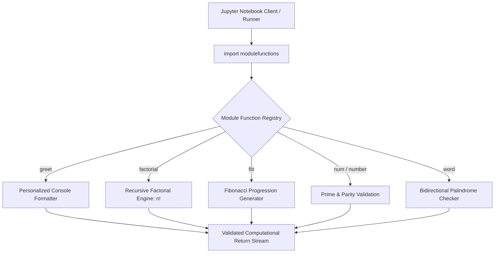

<div align="center">


[](https://www.python.org/)
[](#)
[](https://jupyter.org/)
[](#)

</div>

---

## 📌 Executive Summary / Overview

The **Modular Python Utilities Suite** (`Python-Project`) demonstrates modular software architecture, namespace isolation, recursion, and algorithmic utility programming in Python.

Writing maintainable software requires decoupling algorithmic business logic into reusable packages. This repository establishes a modular Python package structure (`modulefunctions`), verifying clean imports and method dispatch across mathematical functions: recursive factorial calculation, Fibonacci sequence generation, prime and parity validation, and bidirectional palindrome verification.

---

## 📖 Interactive Table of Contents

- [Executive Summary / Overview](#-executive-summary--overview)
- [Key Features & Capabilities](#-key-features--capabilities)
- [System Architecture & Module Workflow](#-system-architecture--module-workflow)
- [Tech Stack Breakdown](#-tech-stack-breakdown)
- [Module Function Catalog & Mathematical Logic](#-module-function-catalog--mathematical-logic)
- [Reproducible Quickstart & Setup](#-reproducible-quickstart--setup)
- [Project Directory Layout](#-project-directory-layout)
- [Author & Contributions](#-author--contributions)

---

## ✨ Key Features & Capabilities

- **Modular Namespace Decoupling**: Eliminates redundant script code by importing self-contained algorithmic routines via `import modulefunctions`.
- **Recursive Factorial Computation**: Mathematical evaluation of $n! = n \times (n-1)!$ with appropriate base-case boundaries.
- **Fibonacci Sequence Generator**: Generates discrete Fibonacci series progression demonstrating memoization and loop states.
- **Primality & Parity Validator**: Tests integer factor divisibility and modular arithmetic parity ($n \pmod 2$).
- **Bidirectional Palindrome Verifier**: Symmetric two-pointer string verification evaluating mirror equivalence (`"amma"` $\to$ True).

---

## 🏗️ System Architecture & Module Workflow



---

## 🛠️ Tech Stack Breakdown

| Category | Technologies & Tools |
| :--- | :--- |
| **Language** | Python 3.9+ |
| **Architectural Pattern** | Modular Programming, Reusable Helper Libraries |
| **Algorithms** | Recursion, Prime Sieve / Trial Division, String Reversal |
| **Environment** | Jupyter Notebook (`Untitled5.ipynb`), Interactive REPL |

---

## 🔬 Module Function Catalog & Mathematical Logic

| Function Name | Input Signature | Logic / Mathematical Formulation | Output Type |
| :--- | :--- | :--- | :--- |
| `greet(name)` | `str` | String template interpolation | Console Print |
| `factorial(n)`| `int` | $n! = \prod_{i=1}^n i$ with base case $0! = 1$ | `int` |
| `fib(n)` | `int` | $F_n = F_{n-1} + F_{n-2}$ with $F_0=0, F_1=1$ | `int` / `list` |
| `number(n)` | `int` | Parity: $n \pmod 2 == 0$ | Boolean / String |
| `word(text)` | `str` | Symmetry verification: $s == s^R$ | Boolean |

---

## 🚀 Reproducible Quickstart & Setup

### Prerequisites
- Python 3.9+ installed

### Step 1: Clone the Repository
```bash
git clone https://github.com/Jeshwanthika07/Python-Project.git
cd Python-Project
```

### Step 2: Run in Jupyter Notebook or Python Shell
```bash
pip install jupyterlab
jupyter lab "Untitled5.ipynb"
```

---

## 📂 Project Directory Layout

```text
Python-Project/
│
├── Untitled5.ipynb            # Interactive notebook testing module function imports
└── README.md                  # Comprehensive modular documentation
```

---

## 👩‍💻 Author & Contributions

Authored by **[Jeshwanthika Pothamchetty](https://github.com/Jeshwanthika07)**  
*Alliance University | Department of Computer Applications*

<div align="center">


</div>
